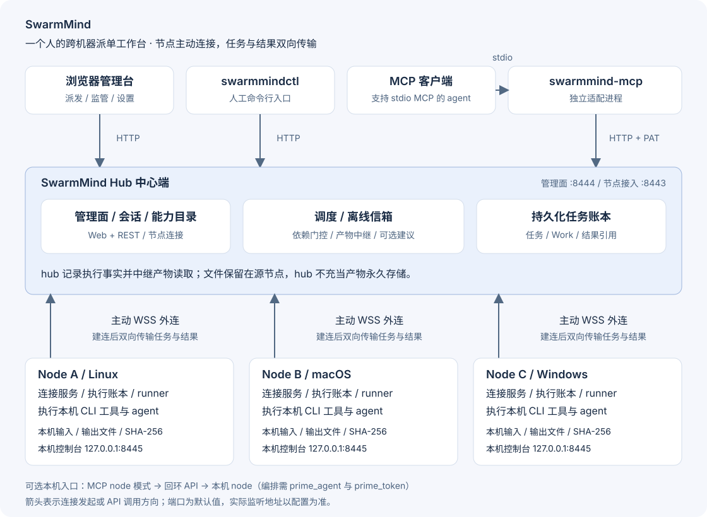

# SwarmMind

<p align="center">
  <picture>
    <source media="(prefers-color-scheme: dark)" srcset="assets/brand/logo-github-dark.svg">
    
  </picture>
</p>

**SwarmMind 是面向个人自托管场景的跨机器 agent 任务调度与结果管理系统。** 用户通过统一入口调用不同机器上的能力，跟踪任务状态并获取最终答复与产物。节点离线时任务暂存；执行结果不确定时进入待人工核对状态。

典型用途包括 Linux 构建、macOS 代码分析、Windows 文件处理，以及多步骤任务协作。用户可以直接指定执行者，也可以指定一个 agent 担任 **Prime（编排角色，界面显示名为「智行管家」）**，负责拆解任务、派发执行和汇总结果。

Go 实现；hub、node、CLI、MCP 分别构建为独立可执行文件。运行核心服务无需外部数据库或消息队列；实际执行的 agent、CLI 工具及其凭据需在节点上另行准备。

[快速体验](#快速体验) · [搭建自己的网络](#搭建自己的网络) · [接入 MCP](#接入-mcp) · [架构详解](docs/ARCHITECTURE.md) · [文档导航](docs/README.md)

## 主要功能

| 能力 | 使用方式 |
|---|---|
| 跨机器任务调度 | Web 管理台、CLI、REST API 或 MCP 指定节点和 agent |
| 离线暂存与恢复 | 节点主动连接 hub；断线后重连、补推任务、补传结果 |
| 执行边界 | 固定命令与工作目录，参数和环境变量逐项授权，超时或取消终止进程组 |
| 文件协作 | 自动登记产物；同机与跨机依赖挂载，取回时校验 SHA-256 |
| 多 agent 协作 | Prime 拆任务、协作群记录讨论、任务结果回流 |
| 日常管理 | 双端 Web 控制台、PAT 访问令牌、任务终态通知、Windows 服务化 |

**可靠性边界：** 重复投递在同一节点账本内去重；执行中断且结果不确定时进入 `needs_review`，由人核对后决定下一步。这不等于对任意外部副作用提供全局 exactly-once 保证。账本、配置和节点身份应持续保留。

## 系统架构



- **Hub 中心端**负责目录、任务账本、离线信箱、调度与产物中继；管理面与节点接入口分开监听。
- **Node 节点**运行在每台执行任务的机器上，主动通过 WSS 连接 hub，无需开放节点公网入站端口；任务在本机 agent 中执行。
- **MCP 服务**是独立的 stdio 适配进程，默认调用 hub HTTP API，也可切换为本机 node 模式。
- **产物**保存在源节点磁盘；跨机读取经 hub 中继，hub 不充当产物永久存储。

[查看组件职责、任务时序和安全边界](docs/ARCHITECTURE.md) · [编辑图源](docs/assets/architecture.mmd)

## 快速体验

前置：**Go 1.24+、bash、python3、curl、pgrep/pkill**；回环演示适用于 macOS、Linux 或 WSL。原生 Windows 的 node 支持前台运行和系统服务。

在仓库根目录执行：

```bash
./scripts/demo-loopback.sh
```

脚本在临时目录中构建并启动一个 hub、两个 node，使用临时端口，演练任务提交、超时、离线补推、重启恢复、幂等、权限拒绝与 `needs_review`，另含 WSS / TOFU 演示。成功清理临时现场，失败保留日志并打印路径。运行耗时取决于构建缓存和机器性能。

看到「全部通过」表示本机回环场景通过；构建/单测与真实双机验收分别执行，不能由这条输出替代。

## 搭建自己的网络

以下最小示例适用于 **macOS / Linux**，先用本机 echo 验证，再把 node 配置移到目标机器。命令均在仓库根目录执行，hub 和 node 使用独立数据目录。

### 1. 构建四个程序

```bash
make build
```

输出：`hub`、`swarmmind-node`、`swarmmindctl`、`swarmmind-mcp`。也可用 `go build -o <输出路径> ./cmd/<入口>` 单独构建；中心端入口是 `cmd/hub`，节点入口是 `cmd/node`。

### 2. 配置并启动 hub

分别执行两次 `openssl rand -hex 32`，得到管理令牌和此节点专用的接入令牌，替换下方占位内容。

```yaml
# hub.yaml
node_listen: 127.0.0.1:8443
api_listen: 127.0.0.1:8444
admin_token: "<管理令牌>"
nodes:
  mac-mini: "<节点接入令牌>"
data_dir: ./data/hub
tls:
  insecure_loopback: false
```

```bash
./hub --config hub.yaml
```

浏览器打开 `http://127.0.0.1:8444`，用管理令牌登录。hub 自动生成节点接入所需的自签 TLS 证书，存入自己的 `data_dir`。

跨机器部署时，将 `node_listen` 改为 `:8443`，放行该端口；node 的 `hub_url` 改用中心端实际地址。管理面可保持回环监听，通过 SSH 转发访问，详见[部署与常见问题](docs/OPERATIONS.md)。

### 3. 配置并启动 node

在另一个终端准备 `node.yaml`：

```yaml
# node.yaml
node_id: mac-mini
hub_url: wss://127.0.0.1:8443/ws/node
register_token: "<与 hub.yaml 中 mac-mini 相同的节点接入令牌>"
hub_pubkey_fp: ""
local_listen: 127.0.0.1:8445
data_dir: ./data/node
concurrency: 2
base_env:
  PATH: /usr/bin:/bin
  TMPDIR: /tmp
agents:
  - name: echo
    kind: cli
    command: /bin/echo
    workdir: /tmp
    timeout_sec: 30
    allow_args: true
    description: 回声测试
```

```bash
./swarmmind-node --config node.yaml
```

管理台「机器」页显示在线后即可提交任务。本机控制台是 `http://127.0.0.1:8445`，登录令牌自动写入 node 的 `./data/node/local_token`。

`hub_pubkey_fp` 留空使用 TOFU：首次连接记录证书公钥指纹，后续校验。首次连接需处于可信网络；要验证首连身份，应预先填入通过可信渠道获取的指纹。配置字段详见 [hub 示例](configs/hub.example.yaml)与 [node 示例](configs/node.example.yaml)。示例文件默认是回环明文开发模式，复制时须同时核对 `tls.insecure_loopback` 与 `ws://` / `wss://`。

也可用管理台「添加机器」向导生成接入配置和部署包；向导生成节点令牌后，仍需按提示更新 hub 的 `nodes` 配置并重启 hub。

### 4. 提交任务并查看结果

管理台「任务派发」选 `mac-mini` → `echo`，提交后到「任务监管」查看。命令行等价操作：

```bash
./swarmmindctl --hub http://127.0.0.1:8444 --token '<管理令牌>' \
  submit --node mac-mini --agent echo --arg hello

# 将返回的任务 ID 替换到下面
./swarmmindctl --hub http://127.0.0.1:8444 --token '<管理令牌>' \
  query --id '<任务ID>'
```

CLI 的 `--token` 使用管理令牌，CLI 会登录换取会话 cookie。脚本直接调 REST 和 MCP 时使用 PAT，不能把管理令牌当作 Bearer 令牌。

### 5. 接入自己的 agent

把 `echo` 换成目标机器上已安装工具的**绝对路径**，设置已有的 `workdir`、固定参数 `agent_args`、超时和授权项；agent 所需的 HOME/配置目录由 `config_home` 指定。node 不继承启动进程的完整环境变量，依赖的 PATH、语言或其他变量需显式配置。

任务输出文件写到自动注入的 `$SWARM_OUTPUTS_DIR`，结束后登记产物。依赖任务可用 `depends_on` 声明上游，系统在执行前准备输入。详见[文件协作设计](docs/FILE-COLLAB.md)与[架构详解](docs/ARCHITECTURE.md)。

## 接入 MCP

在 hub 管理台「设置」创建 PAT（`smsw_` 前缀，明文只显示一次），再向支持 MCP stdio 的客户端加入：

```json
{
  "mcpServers": {
    "swarmmind": {
      "command": "/绝对路径/swarmmind-mcp",
      "env": {
        "SWARM_HUB_URL": "http://127.0.0.1:8444",
        "SWARM_HUB_TOKEN": "smsw_替换为实际PAT"
      }
    }
  }
}
```

`127.0.0.1` 指 **MCP 进程所在机器**。如果 hub 在远端，先配置 SSH 转发或 HTTPS 反代，不能直接照填远端机器的回环地址。

配置完成后，可向 MCP 客户端发出以下请求：

> 列出在线机器和可用能力，把 hello 派给 mac-mini 的 echo，等任务结束并返回结果。

| 工具组 | 工具 |
|---|---|
| 发现与执行 | `swarmmind_nodes`、`swarmmind_agents`、`swarmmind_submit`、`swarmmind_status`、`swarmmind_wait`、`swarmmind_artifact` |
| 全网任务与分配建议 | `swarmmind_tasks`、`swarmmind_dispatch_suggest`、`swarmmind_decide`（旧建议接口） |
| 协作群 | `swarmmind_group_create`、`swarmmind_group_list`、`swarmmind_group_say`、`swarmmind_group_messages`、`swarmmind_group_close` |
| 多步骤工作单 | `swarmmind_work_create`、`swarmmind_work_get`、`swarmmind_work_list`、`swarmmind_work_takeover`、`swarmmind_work_collect` |

当前 hub 模式装配 **19 个工具**，node 模式装配 **6 个工具**。映射和参数以 [SPEC 六.六](SPEC.md)及客户端 `tools/list` 为准。

Work 支持步骤计划、执行尝试、任期接管与报告收集。派发建议服务为可选能力：当前 provider 使用 LLM 生成候选建议，用户可以覆盖建议或直接指定执行者；返回的置信度不代表经过校准的成功概率。功能与验证状态见下文。

**仅在本机编排：** 设置 `SWARM_TARGET=node`、`SWARM_NODE_URL=http://127.0.0.1:8445`、`SWARM_NODE_PRIME_TOKEN=<node data_dir/prime_token 内容>`。node 配置须声明 `prime_agent` 才激活编排入口。本机模式只有发现与执行组的六个工具，不提供全网任务列表、协作群或工作单。

## 核心概念

| 概念 | 含义 |
|---|---|
| Agent / 能力 | 节点管理员配置的一条执行配置：命令、目录、权限和超时 |
| Task / 任务 | 一次派发及其状态、答复、退出码和产物引用 |
| Artifact / 产物 | agent 写到输出目录、经登记并可校验取回的文件 |
| Prime / 智行管家 | 被指定来拆解和编排任务的 agent；不是额外常驻服务 |
| Group / 协作群 | 围绕目标记录讨论的空间，不替代任务执行账本 |
| Work / 工作单 | 多步执行记录，保存计划、步骤、尝试、接管事件和收集报告 |
| `needs_review` / 等你确认 | 结果不确定的任务终态，需人工核对，不静默重跑 |

## 部署与维护

- Linux：仓库提供 [hub systemd 单元](deploy/swarmmind-hub.service)与 [node systemd 单元](deploy/swarmmind-node.service)，安装前核对配置、二进制和工作目录路径。
- Windows：node 支持 `service install/start/status/stop/remove`；管理员命令与真机验收项见[双机部署指南](docs/DEPLOY-P2.md)。
- 构建产物：`make release` 按 Makefile 中列出的目标生成到 `dist/`，不代表所有程序都覆盖所有平台。
- 端口、令牌区别、反代、恢复和容量限制见[部署与常见问题](docs/OPERATIONS.md)。

## 开发与验证

```bash
go build -mod=readonly ./...
go test ./...
# 更深入的本地检查（CI 也执行 vet 与 race）
go vet ./...
go test -race ./...
```

[测试计划](docs/TESTPLAN.md)覆盖 SPEC DoD；[双机验收](docs/DEPLOY-P2.md)需两台真实机器和真实 agent。测试报告有各自的版本和环境，不能视作任意后续工作区的通过证明。

当前开发分支包含 **P5 Work W1–W3 实现**，并已有 [W4 隔离双机验收报告](docs/TESTREPORT-w4-p5.md)。报告适用于其记录的版本与环境；本轮核对发现仓内 B/C 最终关闭证据不完整，见报告附注。该报告不表示当前分支已合入 main 或已部署生产。

**P5.1 D1 派发建议**已加入代码；[D1 测试计划](docs/TESTPLAN-D1-jev.md)仍登记终版真实模型逐场景报告待补录。群聊自动分配、本地 provider 和级联策略仍属后续范围。P4 真实使用观察的完成状态另按[观察期方案](docs/OBSERVATION-P4-plan.md)记录。长期路线见[总方案](docs/PLAN.md)与[产品方向](docs/PRODUCT-DIRECTION-v2.md)。

## License

[MIT](LICENSE)
