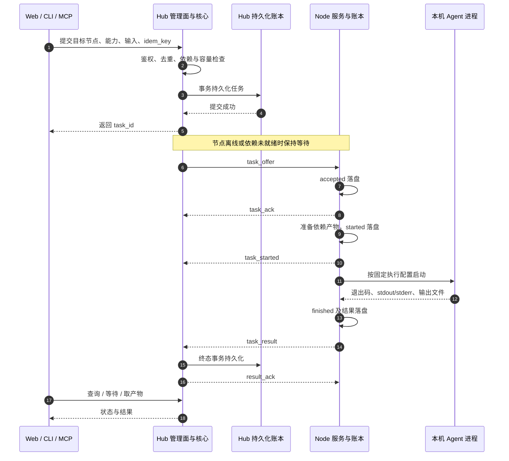
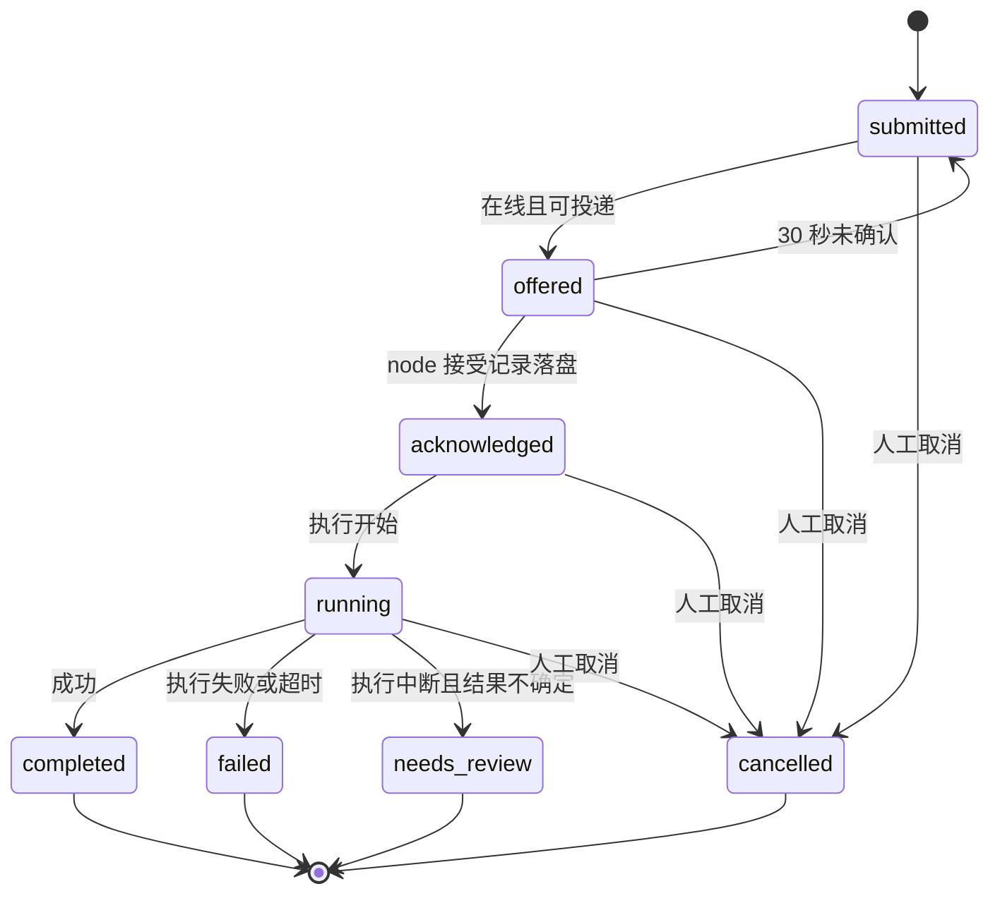

# SwarmMind 架构详解

本文用于理解当前代码中的组件职责和数据流。协议、字段和错误语义以 [SPEC](../SPEC.md) 为准；P5 工作单仍按 [RFC](RFC-work-resume.md) 分批交付。

## 1. 部署拓扑与入口

图源：[Mermaid](assets/architecture.mmd) · [SVG](assets/architecture.svg)。箭头标明连接发起或 API 调用方向；WSS 建连后承载双向任务与结果消息。

| 进程 | 入口 | 职责 | 默认监听 / 连接 |
|---|---|---|---|
| Hub | `cmd/hub` | 节点会话、目录、任务状态、投递、离线信箱、产物中继 | 节点入口 `:8443`；管理面 `127.0.0.1:8444`；实际以配置为准 |
| Node | `cmd/node` | 本机能力配置、执行账本、执行器、输入准备和产物读取 | 本机 API `127.0.0.1:8445`；主动连接 hub `/ws/node` |
| CLI | `cmd/swarmmindctl` | 人工 submit/query/agents/nodes/review | HTTP 调用 hub，管理令牌换会话 cookie |
| MCP | `cmd/swarmmind-mcp` | 将 MCP stdio 工具调用适配为 REST 调用 | 默认 hub 模式，也可选择 node 模式；不自建公网监听 |

hub 管理面包含 Web 控制台与 REST API；node 本机控制台用于配置服务、查看本机任务和接入中心端。独立模式下 node 可在没有 hub 时执行本机任务；node 模式 MCP 的编排权限还要求配置 `prime_agent`。

## 2. 一次任务如何完成

这是成功路径的概念时序。结果可能先于中间态被 hub 处理；完整迟到事件仲裁见 SPEC 4.3。`swarmmind_wait` 通过轮询查询等待终态。

三个确认点各有明确含义：提交响应表示 hub 已落盘；`task_ack` 表示 node 已把接受记录落盘；`result_ack` 表示 hub 已持久化终态。丢失确认后靠重传和去重收敛。

## 3. 状态与恢复

图展示主要路径；任何非终态都可能因过期而失败，结果也可先于中间态到达。四种终态不回退；取消后的迟到执行数据按 SPEC 仲裁合并。

| 故障 / 风险 | 收敛机制 | 边界 |
|---|---|---|
| 节点离线 | hub 信箱暂存，重连后补推 | 默认 7 天过期；还有条数/字节配额 |
| 同次提交重试 | `idem_key` 同键同内容返回原任务；同键异内容冲突 | 普通任务去重随任务生命周期；Work 另保留绑定去重证据 |
| 重复投递 | node 查本机账本，不再次启动相同任务 | 依赖同一 `data_dir`，不能删除账本后期待去重仍在 |
| 执行中节点崩溃 | started 未 finished 的记录恢复为 `needs_review` | 需人核对实际副作用，禁止自动当成未执行 |
| 结果回传时断网 | finished 未确认的结果重连补传并定时重发 | 收到确认或终态冲突后停止 |
| 旧会话 / 旧执行回写 | 会话 epoch 隔离旧连接；任务租约隔离过期执行结果 | 两种代次约束独立，不能互相替代 |
| hub 重启 | 快照恢复任务、epoch 等状态；node 重连 | 不提供多 hub 高可用或节点间直连 |

## 4. 文件协作

1. runner 注入 `SWARM_TASK_ID`、`SWARM_TRACE_ID`、`SWARM_OUTPUTS_DIR`；agent 将输出写入 `<workdir>/outputs/<task_id>/`。
2. 执行结束登记产物元数据，包含相对路径、大小与 SHA-256；文件保留在执行节点。
3. 下游通过 `depends_on` 声明上游任务的幂等键。依赖未就绪不执行，准备输入时检查登记信息。
4. 同机读取本地源文件；跨机通过 node → hub → 源 node 请求，由 hub 中继返回。
5. 校验大小与 SHA-256 后，将输入发布到下游工作目录的 `inputs/<上游task_id>/`。多步发布通过 journal 支持崩溃恢复。

源文件读取统一经过 `inputs.OpenSourceFile`，在打开操作中约束符号链接/重解析点；普通文件检查使用已打开的 fd。路径定界与原子发布防止不可信工作目录将文件操作引出授权范围。具体实现见 `internal/node/inputs/`、`internal/node/service/remotefetch.go` 和 `internal/hub/core/artifact.go`。

产物受协议大小和数量限制，并非任意大文件传输；hub 不保存永久镜像，源节点离线、原文件消失或校验不符时无法正常取回。详见[运行限制](OPERATIONS.md)。

## 5. 身份、权限与传输边界

| 边界 | 机制 |
|---|---|
| node → hub | 每节点独立 `register_token` 与 node_id 绑定；WSS、SPKI 指纹或 TOFU |
| 人 → hub 管理台 / CLI | 管理令牌登录换会话；管理台另支持账户密码流程 |
| 外部脚本 / hub MCP → hub | Bearer PAT（`smsw_` 前缀），在管理台创建/撤销 |
| 人 → node 本机控制台 | `local_token`；本机回环监听 |
| 本机编排 MCP → node | `prime_token`，并要求配置 `prime_agent` |
| 任务 → 操作系统 | 固定 command/workdir/agent_args、args/env 授权、独立环境基线、超时/进程组治理 |

执行权限由节点主人定义。SwarmMind 的执行配置控制不等于操作系统沙箱：agent 实际能做什么仍取决于运行账户权限及 agent 自身的限制。

审计中的 `principal` 来自服务端鉴权；`submitted_by`、`created_by`、`prime_term` 等标签不能单独证明调用方身份。管理面 HTTP 与节点 WSS 是两个入口，节点链路加密不代表远程管理面也自动具备 HTTPS。

## 6. Prime、协作群与工作单

- **Prime** 是既有 agent 的编排角色，调用普通任务提交工具执行拆解后的子任务。
- **协作群**记录讨论与结果消息，不作为正式的步骤绑定或接管依据。
- **Work** 保存正式的多步执行记录。当前实现包含创建/查询、任期接管、绑定派发、终态回写和报告收集；hub 管理台提供 Work 列表与详情。W4 双机故障测试有单独的历史报告，其版本、部署范围与采证缺口见 [报告](TESTREPORT-w4-p5.md)。
- **分配建议**由 hub 内嵌的 `internal/decision` 服务提供，REST/MCP 查询当前在线且开放的候选，返回可覆盖的建议。D1 使用 LLM provider；本地模型、群聊自动分配和概率校准未作为当前能力验收。

接管依赖当前任期的比较后更新：旧任期续派被拒，其已发任务的执行事实仍可回流。Work 续管不意味着自动选主、后台自动重派或自动解决 `needs_review`。

## 7. 源码导航

| 目录 | 阅读目的 |
|---|---|
| `internal/protocol/` | 信封、状态、数据类型、依赖与容量常量 |
| `internal/hub/api/`、`internal/hub/web/` | REST / 登录 / 接入向导与管理台 |
| `internal/hub/core/` | 提交、调度、取消、结果、依赖、租约、产物中继、Work |
| `internal/hub/session/`、`mailbox/`、`store/` | 会话/心跳、离线投递、事务快照 |
| `internal/node/conn/`、`service/` | 外连和重连、帧处理、本机任务调度 |
| `internal/node/ledger/`、`runner/`、`inputs/` | 执行事实、进程/产物、依赖文件准备 |
| `internal/node/localapi/`、`web/` | 本机配置、任务清单与控制台 |
| `internal/decision/` | 派发建议 provider、候选验证与降级处理 |
| `internal/notify/`、`internal/settings/` | 双端共用通知与配置存储 |
| `cmd/swarmmind-mcp/` | 两种 MCP 后端与工具定义 |

建议顺序：README → 本文 → SPEC 4.3/4.5/4.8 → `internal/hub/core/fullchain_test.go` → node ledger/runner，再阅读具体功能测试。
