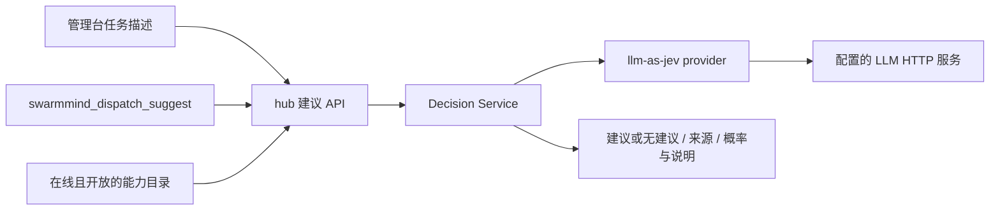

# RFC：执行者分配建议服务（P5.1）

> 设计决策日期：2026-10-26。当前 D1 实现为 `llm-as-jev`：使用 LLM 按有限候选选择的形式返回建议，不代表已经部署 Jev 原生模型或完成概率校准。
> 实现见 `internal/decision/`，当前验收记录见 [TESTPLAN-D1-jev](TESTPLAN-D1-jev.md)。本文不维护外部模型的价格、性能或准确率宣传数据。

## 一、目标与范围

用户填写任务描述后，系统从当前在线且开放的 agent 中提供执行者建议，减少人工查询能力目录的步骤。用户可以采纳、改选或直接提交；建议不是派发的必经条件，也不授予额外执行权限。

本专题采用有限选项选择（Choice）的接口形式。Noul、Score、多问题并行和按置信度自动派发属于后续研究范围，不能从当前 D1 接口推导已经支持。

## 二、当前架构

服务内嵌于 hub，不新增常驻服务进程或 node 监听。当前候选摘要包含 node、agent、描述、类型、权限说明和在途负载，不发送本机工作目录或完整 ExecProfile。

D1 通过配置的兼容 Chat Completions HTTP 端点调用模型。默认配置采用 GLM 模型与端点；本地 provider、Jev 云原生 provider 和多 provider 切换仅是接口扩展方向，当前未全部实现。

## 三、接口与降级

REST：`POST /api/v1/dispatch-suggest`，请求提供 `goal` 或 `step_desc`。MCP：`swarmmind_dispatch_suggest`，hub 模式专属。候选由 hub 从目录构造，调用者不能提交任意候选集合。

| 情况 | 当前响应语义 |
|---|---|
| 请求无有效描述 | HTTP 400 |
| 未通过鉴权 | HTTP 401 |
| 有有效建议 | HTTP 200，返回候选内目标、来源、理由与概率字段 |
| 服务未启用 | HTTP 200，`suggestion:null`、`degraded:true`，note 说明未启用 |
| 无候选或模型判断无适合目标 | HTTP 200，`suggestion:null`、`degraded:false`，由 note 区分原因 |
| 已启用 provider 的超时、请求/解析失败或目标不在候选中 | HTTP 200，`suggestion:null`、`degraded:true`，返回概括性说明 |

无建议或建议服务故障不阻止普通任务提交。provider 上游原始错误只记入 hub 日志，响应不回传可能包含凭据的原文。

概率字段覆盖候选并归一化，缺失值按实现规则补齐。**归一化仅约束数值形式，不证明统计校准**；LLM 自报置信度也不能当作任务成功概率。阈值自动派发需要单独的数据评估与授权设计。

## 四、管理台与配置

管理台派发页提供获取与采纳建议操作。采纳只回填目标选择，不直接提交；任务描述变化后旧建议失效。控制台当前不显示概率百分比；REST/MCP 可返回数值用于诊断。

现有界面使用固定标签「本地决策模型」，但 provider 可能调用外部服务。文档和部署判断应以 `decision.provider`、`base_url` 及实际网络目标为准，不能把该标签解释为本机推理证明。

密钥来源依次为 hub 配置、环境变量和指定 Prime HOME 中的 provider 配置。配置项见 [hub 示例](../configs/hub.example.yaml)。外部服务可以接收任务描述明文和候选摘要；本地部署方案需另外验证，不能因接口预留而视为已具备。

## 五、分批交付与验证状态

| 批次 | 范围 | 当前状态 / 验收要求 |
|---|---|---|
| D1 | provider 抽象、llm-as-jev/Choice、REST/MCP、管理台建议 | 已实现；自动化测试记录与终版真实模型复验分别核对 |
| D2 | 群聊目标与分配建议、正式任务派发联动 | 规划，现有普通群消息不自动触发 |
| D3 | 本地 provider、级联策略、多问题与模型对照 | 规划，需要部署、延迟、准确率与校准评估 |

早期规划为 50 个中文场景；D1 执行计划调整为 22 个已标注场景，目标为至少 18 个正确，50 例规模留待 D3 扩大对照。样本减少不能表述为同等统计置信水平。

D1 测试计划记有历史 22/22 汇总，但终版代码的逐场景真实模型复验因凭据/环境依赖仍待补录。本轮文档验证不消耗模型额度，不把历史汇总或自动跳过的 live 测试视为终版重新通过。

## 六、已确定的决策

1. D1 先采用 llm-as-jev 便于集成，D3 再比较本地方案。
2. 建议保持可覆盖，界面先展示目标与来源，概率展示和阈值策略需谨慎评估。
3. agent 自行认领不在本阶段立项，先验证 Prime 编排与建议服务的实际效果。
4. 两个现有工具分别保留：新 `swarmmind_dispatch_suggest` 走 hub 服务；旧 `swarmmind_decide` 走 MCP 自身的 StartLux/L2 路径，参数和候选来源不同。
