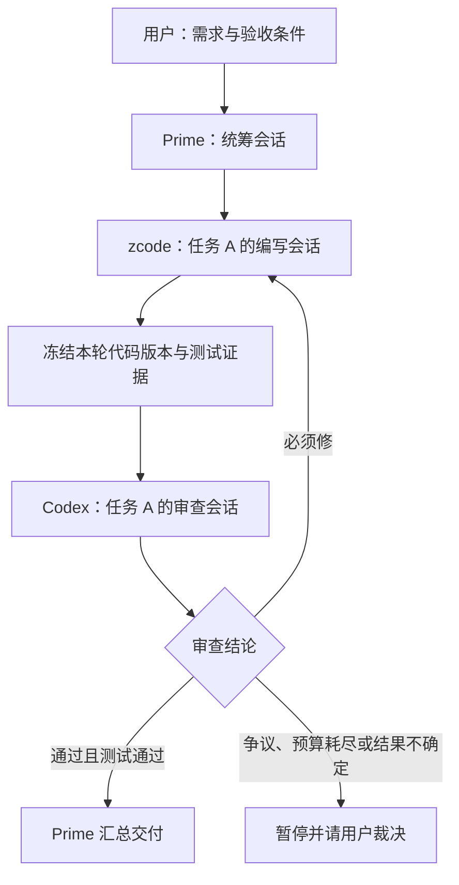

# SwarmMind：远程原生 agent 与持久会话协作

> 2026-10-29，依据用户实际工作场景整理的产品目标与方案草案。
> 本文确定要解决的问题，提出下一阶段设计与验收目标；不表示持久会话、自动审查循环已经实现。现行协议仍以 [SPEC](../SPEC.md) 为准，实施前需补齐协议、REST/MCP 映射和专项测试。
> 本机接入探针已完成：Codex 0.164.0 与 zcode runtime 0.17.0 均在独立进程中按明确原生 ID 完成两轮续聊；zcode edit 模式存在 Bash 权限客户端限制。详见[实测与适配决策](archive/TESTREPORT-native-session-20261029.md)。这不表示平台会话层或跨机协作已实现。

## 一、系统为什么存在

**让用户从任意获授权的入口，使用不同机器上已经配置好的原生 agent，并在各自持续的对话线程中完成长期协作。**

用户实际遇到三个相互关联的问题：

1. **能力被机器隔离。** 公司机器已配置好 Codex、模型访问和项目环境，回到家后无法直接使用这个完整执行环境。需要远程委派给公司机器上的 agent，让工作仍在原机器执行。
2. **不同 agent 有各自适合的模型与环境。** 在用户当前体验中，Codex 搭配 GPT 的效果优于替换成 GLM。系统应保留用户选择的 agent、模型、账号配置、工具与权限组合，不强制所有 agent 改用同一个模型接口；这种体验不是对所有模型组合的普遍性能结论。
3. **协作需要持续对话。** zcode 写代码、Codex 审查、另一 agent 统筹，往往要多轮返工。每轮新建会话会丢失原线程积累的背景，反复解释也增加等待与消耗。用户希望每个子任务有自己的长期线程，审查意见能准确回到原编写线程。

跨机执行是基础，多轮会话是日常使用单位，编排循环是这些会话之间的协作方式。已有的一次性构建、脚本和文件处理任务仍保留。

## 二、两条主场景

### 场景 A：家里使用公司机器上的 agent

用户在家里的入口选择「公司节点 / Codex / 项目 A」，新建或打开一个已有对话，发送问题，查看执行进度和答复；第二天继续该对话时，仍对应公司节点上的同一原生会话与项目工作区。

模型访问、凭据和执行工具留在公司节点。Hub 转发被授权的任务、消息与结果，不要求把模型密钥搬回家，也不承诺账户或模型额度可以跨账号共享。

**连通前提：** 公司节点须获准主动连接一个双方可达的 Hub，家里入口须能访问其管理面；也可通过组织允许的私网或隧道连通。没有允许的网络路径时系统不能工作，WSS 主动外连不能穿透所有隔离政策。当前 Hub 可读取经其转发的内容，WSS 不等于端到端加密；数据能否离开内网须符合该环境的授权范围。

### 场景 B：编写—审查—返工的持续循环

用户把需求交给 Prime。Prime 澄清需求和验收标准，为任务 A 绑定 zcode 编写线程 A 和 Codex 审查线程 A；为任务 B 另建两条线程，避免交叉污染。

每次返工向原编写会话追加反馈，每次复审向原审查会话提交新版本。Prime 保存进度、问题编号、每条意见的修复次数、证据和下一步；人可以随时补充需求、暂停或接管。图中的循环是目标流程，不是当前 Hub 自带的自动调度行为。

## 三、先区分任务、会话和工作单

| 对象 | 负责保存什么 | 生命周期与关系 |
|---|---|---|
| Agent 配置 | 节点上的命令、模型接入配置、HOME、工具与权限基线 | 一个配置可服务多个独立会话；敏感凭据留在节点 |
| Session / 会话（拟新增） | 平台会话 ID、节点/agent/工作区绑定、原生会话 ID、能力与恢复状态 | 跨越多轮调用，不随单次任务结束而销毁 |
| Turn / 轮次（拟新增） | 一次用户或编排者输入、序号、消息幂等键、执行状态和答复引用 | 属于一个会话；执行可关联现有 Task，不能把 Task ID 当原生会话 ID |
| Task / 任务（已有） | 一次执行的投递、状态、输出与产物 | 单轮执行的可靠性基础；一次性 CLI 任务不要求创建 Session |
| Work / 工作单（已有） | 目标、步骤、尝试、接管和收集记录 | 记录跨会话协作事实，不保存任意 agent 的内部对话状态 |
| Group / 协作群（已有） | 人与 agent 之间的讨论和关联消息 | 群历史不等于任何参与者的原生会话 |

平台 ID 与原生会话 ID 必须有持久映射。不能使用「最近一次会话」作为默认恢复目标，否则同时处理 A/B 时可能串线。模型、agent 版本、配置及工作区绑定变化必须可追踪；需要换 agent 或迁移节点时应明确作为迁移/新会话处理，不能静默宣称原线程继续。

## 四、会话持续性的准确含义

**无头运行与一次性会话是两个维度。** 某种 CLI 若支持按明确原生 ID 恢复会话，即使每轮启动新进程，也可能满足持续对话；长期保留 TUI 进程本身则不能证明崩溃后可恢复。

目标是保留 agent 自身支持持久化和恢复的对话历史、工具记录与状态，以及工作区中的代码和项目资料。上下文窗口、压缩和恢复范围由原生 agent 决定；系统不保证完整恢复模型内部不可访问的思维链、每轮速度提升或零上下文损失。

接入层按实际验证能力分级，以下是设计类别，不是某个产品已支持的功能清单：

| 类别 | 适用接入方式 | 产品承诺 |
|---|---|---|
| 原生持久会话 | 经验证的原生协议/服务接口，或能显式创建与恢复线程的 CLI | 可按确定 ID 追加输入；重启恢复范围单独验证 |
| 仅进程存活期会话 | 必须维持交互进程或 PTY 才能继续 | 明示退出/崩溃可能丢失会话；不能标为完整持久化 |
| 无原生续聊能力 | 只接受单次提示词的工具 | 保留一次性任务；可显式新建线程并交接摘要，不能伪装为原会话恢复 |

优先验证原生结构化接口，其次显式 ID 的 CLI 恢复；仅在必要时适配 PTY。不能只靠模拟输入和解析终端文本，就假定已经处理好完成信号、权限询问、取消和重连。首批接入先验证用户实际使用的 Codex 与 zcode 版本，记录版本、创建/恢复方式、事件格式及限制，再决定实现。

## 五、在现有架构上补齐什么

### 5.1 Node：掌握原生会话与本机执行

增加会话适配层，负责创建、按 ID 继续、读取状态、取消本轮和关闭会话；各适配器声明是否支持原生恢复、流式事件、权限请求和进程重启恢复。不可支持的操作明确拒绝。

节点保存原生会话映射和必要恢复材料，Hub 保存可路由的索引与协作记录。模型凭据不进入公共能力卡；同机账号/HOME 与工作区边界明确。会话采用单写者：同一线程的输入排序执行，人和 Prime 同时操作也需受同一所有权/队列约束；不同线程可并行，但仍遵守工作区写入互斥与节点配额。

现有 runner 会在一次 Run 结束时回收进程组，不能直接用它托管跨轮存活的交互进程。若采用常驻适配器，应独立定义会话、轮次和进程生命周期；不能为保活而取消现有普通任务的超时与孤儿清理保证。

### 5.2 Hub：记录路由、轮次与可恢复进度

持久化会话路由、轮次顺序、输入幂等记录、事件序号和 Task 关联。客户端掉线不等于取消执行；重连从已确认事件位置补读，不能再次发送同一轮输入来模拟恢复。

在「原生 agent 已收到输入、平台尚未记录完成」的崩溃窗口里，优先用原生轮次 ID/查询能力对账。无法确认执行事实时进入待人工核对，禁止盲目重发可能修改代码的输入。现有 Task 去重不能自动提供原生 agent 副作用的 exactly-once。

活跃会话索引、必要恢复引用与 Work 关联应有独立保留策略；不能随普通任务终态清理而失联。原生会话记录缺失、工作区被删除或版本不兼容时明确标为不可恢复；摘要交接到新线程需记录来源与损失边界。

### 5.3 Prime：管理协作循环

每个子任务保存编写 Session、审查 Session、代码版本和 Work 引用；Prime 自身也应有会话绑定。Prime 中断后，结合其可恢复会话与 Work 中的事实续管，不只依赖聊天记忆。

审查必须绑定代码快照或明确提交/补丁摘要及其哈希、测试命令与结果。跨机时明确仓库基线与交付补丁；已有产物传输不等于 Git 自动同步。审查期间禁止把更新中的工作目录当作固定审查对象；代码再变，旧版本的通过结论不能直接用于新版本。

意见按「必须修 / 建议修 / 可不修」记录稳定问题编号、文件:行号与版本；通过需满足验收条件、相关测试与必须修清零。对 SwarmMind 自身开发，沿用 AGENTS.md 的规则：**同一条意见修两次不过即停止，上报 Hana/用户裁决**。通用流程另设总轮数、时间与调用预算；额度不足可暂停等待，不能未经选择自动替换模型组合。

现有 Work 的步骤计划建单时固定，完成步骤不可直接重派。因此，审查循环如何落到 Work 必须在实施 RFC 中显式确定：例如预先安排有上限的编写/审查轮次，或扩展可重复阶段模型并迁移契约。不能把已完成编写步骤重新提交当作现成支持，也不能让所有业务迭代混成网络重试。

### 5.4 用户与 agent 使用同一套能力

用户入口提供新建/继续会话、查看所属机器/agent/工作区、轮次历史、取消本轮、处理权限请求和关闭会话；明确区分取消本轮与删除历史。权限请求必须送到有权决定的用户，不让编排 agent 自动扩大授权。

新增管理 REST 能力必须同批提供 `swarmmind_` 前缀 MCP 工具并登记 SPEC 六.六；凭据/本机主人专属操作按既有显式豁免规则处理。本文不预占端点和工具名，也不暗示它们已经可调用。

涉及双端的会话组件必须同构，实施任务书应逐项细化以下形态对照并提供双端截图：

| 组件 | Hub | Node | 一致要求 |
|---|---|---|---|
| 会话列表与状态 | 获授权的全网范围 | 获授权的本机范围 | 同状态词、字段顺序和继续入口 |
| 新建/继续表单 | 可选择远端能力 | 固定本机范围 | 同弹层形态、工作区/agent/模型信息顺序 |
| 对话与轮次详情 | 经 Hub 读取 | 读取本机记录 | 同消息/事件布局、等待与失败文案 |
| 暂停、取消与权限提示 | 按授权提供 | 按授权提供 | 同名同义；无权限时明确说明 |

## 六、当前代码与目标之间的距离

以下是 2026-10-29 的源码核对，不是端到端功能验收。

| 能力 | 当前依据 | 与目标的距离 |
|---|---|---|
| 跨机调用已配置 agent | `internal/node/conn/`、`internal/hub/session/`、`internal/node/service/` | 已有连接/任务基础；公司与家庭实际网络及真实 agent 仍需验证 |
| 保留节点侧执行环境 | `internal/protocol/types.go` 的 ExecProfile；`internal/node/runner/runner.go` 的 New/buildEnv | 已有命令、参数、config_home 和环境白名单；不自动继承桌面登录环境 |
| 一次执行 | `internal/node/runner/runner.go` 的 Run | 当前每次启动命令、关闭 stdin、等待和收尾进程；未见统一的原生会话创建/恢复适配层 |
| 会话身份 | `internal/protocol/types.go` 的 Task/TaskInput | 当前任务无专用原生会话/轮次关联契约；手工传 CLI 参数不等于平台管理会话 |
| 多步骤恢复 | `internal/hub/core/work.go`、`internal/hub/core/submit.go`、SPEC 六.五 Work 契约 | 保存执行事实；不会自动恢复 zcode/Codex 的原生线程 |
| Prime 与群协作 | `docs/PRIME-DESIGN.md`、现有 Work/Group MCP | 已有编排基础；固定线程上的审查循环、版本门禁与预算停机尚需设计实现和实测 |

源码中 `hub/session` 和连接 epoch 指节点网络连接；Web 登录 session 指鉴权会话；它们都不能作为原生 agent 对话持久化的证据。

## 七、实施顺序与产品验收

1. **接入验证。** 使用真实版本分别验证 Codex 与 zcode 的显式线程创建、两轮续聊、独立线程隔离和恢复边界；不支持即记录限制，不能先做界面再假定原生能力存在。
2. **单 agent 持久会话。** 落地 Session/Turn、节点适配与 REST/MCP，保留现有一次性 Task 路径；验证断连和崩溃窗口。
3. **双 agent 固定线程循环。** 补 Work 循环模型、代码版本交接、审查判定与停止规则；先完成一个子任务，再扩展多个线程并行。
4. **日常入口与恢复。** 双端会话界面、权限交互、Prime 接管和保留策略验收；满足测试循环制度后再发布。

以下是未来功能的验收用例，**本轮均未执行，不应记为 PASS**；它们补充而不替代 SPEC 七的基础 DoD。

| ID | 操作与采证 | 通过条件 |
|---|---|---|
| S-01 | 两台真实机器，在获准网络上从家里入口调用公司节点；记录路由与原生执行日志 | 执行在指定节点，沿用其模型配置；入口不需要复制模型密钥 |
| S-02 | 同线程首轮给随机约定并修改测试文件，次轮只引用该约定要求继续；记录原生 ID 与两轮事件 | 原生会话 ID 不变、操作衔接正确，未重发整段首轮提示词冒充恢复 |
| S-03 | 同 agent 建 A/B 线程，给不同约定；交错续聊并核对原生 ID、输出和文件 | 线程不串线，同线程双提交按序执行，不同工作区可独立推进 |
| S-04 | 提交后断开客户端再连接；分别在输入送达前后、输出回执前故障注入 | 可确定结果对账，不重复产生副作用；无法对账明确待核对 |
| S-05 | 正常完成一轮后分别重启 Node/Hub，再继续；另在执行中重启 | 恢复范围符合该适配器声明；在途不确定执行不被盲目重放 |
| S-06 | 让 zcode 产出有已知缺陷版本，Codex 提意见，再返工复审；保留版本哈希 | 编写/审查分别保持原线程；结论对应每轮版本，修复后测试和审查均通过才交付 |
| S-07 | 注入反复未修复意见、预算耗尽、权限询问和代码版本变化 | 按规则暂停/等待授权或重新审查，不无限循环、不复用旧通过结论 |
| S-08 | 中断 Prime 后恢复或显式接管，读取 Work 与会话映射 | 接续原线程/原进度，不重复派发；原生会话丢失时明确提示 |
| S-09 | 用 REST 与 MCP 各执行新建、继续、查询、取消，检查拒绝权限场景 | 能力语义一致、错误明确；会话引用不能绕过节点/工作区授权 |
| S-10 | 清理已到期普通任务后继续活跃会话；删除原生记录后再次继续 | 活跃会话引用不随任务清理失联；材料丢失时不静默开新线程 |

第一里程碑的判据是：**用户从远端连续两次进入同一原生 agent 线程，第二次能继续第一次的工作。** 完整目标再加上：**多个编写线程各有自己的审查线程，返工始终回到对应线程，并能在中断后依据事实恢复循环。**
